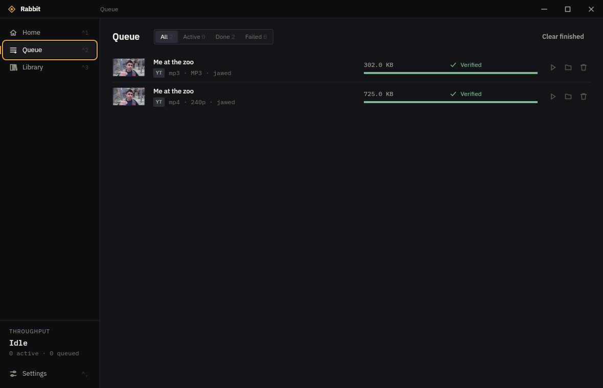

# Linux test results — 2026-10-30

Tested locally on CachyOS x86_64, KDE Plasma 6.8.2 / Wayland, WebKitGTK 2.54.2,
GTK 3.24.52, NVIDIA 615.78.08, Rust 1.99.1 and Node.js 26.12.1.

## Automated checks

| Check | Result |
|---|---|
| `npm ci` | Locked dependencies installed successfully |
| `npm test` | 4 passed |
| `npm run build` | TypeScript and production frontend build passed |
| `python3 -m unittest discover -s scripts -p test_linux_sidecars.py` | 2 passed |
| `cargo test --offline --locked --manifest-path src-tauri/Cargo.toml` | 93 passed; 19 opt-in tests skipped |
| `cargo clippy --offline --locked --manifest-path src-tauri/Cargo.toml --all-targets` | Completed; 10 style/enum-size warnings, no errors |
| `npm run tauri build -- --debug --no-bundle` | Native Linux desktop executable built successfully |
| Live `youtube_video_and_mp3_end_to_end` integration test | Passed; real video, MP3, cover image and merged video/audio downloads |

Total: **100 automated tests passed**, including the explicitly enabled live test.
The full backend suite and Clippy were rerun after the startup fixes.

The backend checks cover segmented HTTP transfers, dropped connections, pause/resume,
cancellation, mirror fallback, cookie host restrictions, stored settings, and verified yt-dlp
update/install/revert behavior. A new Linux integration test uses the actual bundled FFmpeg
and FFprobe to create fixtures, merge streams, convert MP3, verify dimensions/duration,
reject an incorrect promised resolution, and handle paths containing spaces.

Native tool preparation downloaded pinned upstream assets and verified their SHA-256:
yt-dlp 2026.10.21 and BtbN's static LGPL FFmpeg/FFprobe n9.0.2 build.

## Desktop checks

The desktop tests used a separate profile under `/tmp/rabbit-desktop-test`; normal user
settings and library were not modified.

- Native Wayland window rendered correctly; Home, Queue, Library and Settings navigation passed.
- Maximize, restore and close controls worked.
- Increasing simultaneous downloads from 3 to 4 persisted in the test database.
- XWayland keyboard entry detected the public YouTube test URL and analysis displayed the available formats.
- Clicking **Download 240p** saved `Me at the zoo.mp4` (629,172 bytes) into the isolated test folder.
- Queue displayed **Verified**, with one completed task and no failed tasks; Library showed the saved video.
- FFprobe confirmed 320×240 video, an audio stream, and duration 18.947483 seconds.
- Restarting the rebuilt app restored the completed task and library entry.
- The rebuilt XWayland window rendered successfully with the automatic NVIDIA compatibility fix,
  without manually setting a WebKit renderer environment variable.

## Issues fixed during testing

1. The HTTP engine called a Windows-only sparse-file helper on Linux, preventing compilation.
   Linux now uses its existing sparse-file semantics without an NTFS control call.
2. NVIDIA's X11/XWayland GBM path produced a blank WebKit surface. Before starting GTK,
   Rabbit now selects WebKit's fallback renderer for detected NVIDIA/X11 sessions, unless
   the user explicitly set `WEBKIT_DISABLE_DMABUF_RENDERER`. Native Wayland is unaffected.
3. Queue and Library actions now say **Show in folder** instead of naming Windows Explorer.

## Release 0.7.1 package checks

The published [v0.7.1 Linux release](https://github.com/aadiichau/rabbit-linux/releases/tag/v0.7.1)
was built from commit `f2026f0fbe6d9b4ff45e4cf520e3a64644b0f857` on Ubuntu 22.04.
[Linux CI](https://github.com/aadiichau/rabbit-linux/actions/runs/40980515434) and
[Windows/frontend CI](https://github.com/aadiichau/rabbit-linux/actions/runs/40980515485) passed.

The [release staging audit](https://github.com/aadiichau/rabbit-linux/actions/runs/40982810182)
verified all three package checksums, package versions, Debian/RPM metadata, license resources,
and executable permissions for the private yt-dlp, FFmpeg and FFprobe binaries.
The AppImage downloaded from the staged release matched SHA-256
`925c0a4ff97f35cc4d5545d494ef6ac6683dadd63c735fbb0092d12f02f0775c`.

The optimized release AppImage was tested with `--appimage-extract-and-run` on CachyOS:

- Native Wayland and NVIDIA/XWayland windows rendered correctly; the X11 fallback worked automatically.
- All media tools were discovered inside the AppImage's private resources.
- A real GUI download merged video/audio into a 744,412-byte MP4; bundled FFprobe confirmed
  320×240 video, audio, and approximately 19.06 seconds of duration.
- A second GUI download converted audio into a 163,334-byte MP3, confirmed with bundled FFprobe.
- Both tasks displayed **Verified**, with zero failures, and both remained in Queue and Library after restart.

## Scope and remaining checks

The earlier development checks used `src-tauri/target/debug/rabbit`; the additional checks above
used the actual optimized release AppImage. Debian/RPM package contents and permissions were audited,
but installation on Debian or RPM distributions was not tested on this CachyOS host.
Windows CI compiled and tested the source; a Windows desktop smoke test was not performed.

Only the public YouTube sample was downloaded live. The remaining opt-in live platform,
benchmark and signed-in-session tests were not run; these results do not establish live
compatibility with every supported site or account.
